<h1 align="center">Hello, I'm Ismael Nicolas!</h1>

  Developer • Data • Cybersecurity Enthusiast • Freelancer

---

### About Me

- Continuous learner always looking to sharpen my engineering skills across the stack.
- Currently diving deeper into **Data Engineering** and **Cybersecurity**.
- Experienced in building web applications, APIs, data pipelines, and containerized environments.

---

### Tech Stack & Tools

  

 

  <strong>Also worked with &amp; exploring:</strong>

  
  
  
  
  
  
  
  

---

### GitHub Stats

  
  

---

### Contribution Graph

<picture>
  <source media="(prefers-color-scheme: dark)" srcset="https://raw.githubusercontent.com/NiXx2004/NiXx2004/output/pacman-contribution-graph-dark.svg" />
  <source media="(prefers-color-scheme: light)" srcset="https://raw.githubusercontent.com/NiXx2004/NiXx2004/output/pacman-contribution-graph.svg" />
  
</picture>
